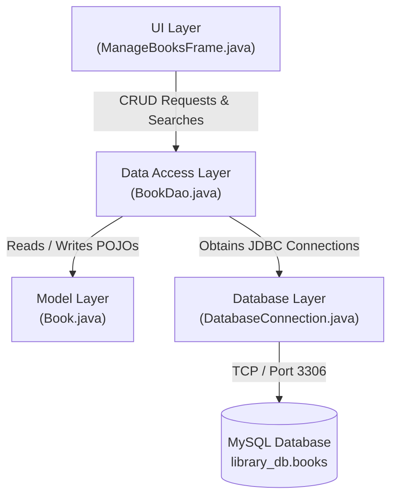

# Library Management System

A desktop-based book management application built with Java Swing and MySQL using a clean 4-layer architecture.

## Features

- **Book Catalog Management**: Add new book records with ID, title, author, category (Fiction / Non-Fiction), price, and description ([`ManageBooksFrame.java`](src/ui/ManageBooksFrame.java), [`BookDao.java`](src/dao/BookDao.java)).
- **Record Modification**: Select any book row in the table to populate the form and update its details in MySQL ([`ManageBooksFrame.java`](src/ui/ManageBooksFrame.java#L198-L232)).
- **Record Removal**: Delete books with a confirmation prompt ([`ManageBooksFrame.java`](src/ui/ManageBooksFrame.java#L235-L270)).
- **Real-Time Search**: Dynamically filter books by ID, title, or author as you type via document change listeners ([`ManageBooksFrame.java`](src/ui/ManageBooksFrame.java#L295-L325), [`BookDao.java`](src/dao/BookDao.java#L107-L141)).
- **Safe SQL Operations**: Uses parameter binding (`PreparedStatement`) across all queries to prevent SQL injection and try-with-resources to prevent connection leaks ([`BookDao.java`](src/dao/BookDao.java)).
- **Separation of Concerns**: Strict decoupling across UI, DAO, Database Connection, and Data Model layers.

## Tech Stack

| Layer | Technology | Version |
| :--- | :--- | :--- |
| Runtime & Language | Java (JDK) | 17+ (Tested on JDK 27) |
| GUI Toolkit | Java Swing / AWT (`java.desktop`) | Standard Library |
| Database Connector | MySQL Connector/J | `26.7.0` (`lib/mysql-connector-j-26.7.0.jar`) |
| Database Engine | MySQL Server | 8.0+ |

## Architecture

The project follows a 4-tier desktop architectural pattern:



- **UI Layer ([`src/ui/`](src/ui/))**: Renders the Swing interface, handles user actions (Add, Edit, Remove, Search), and binds table selection to form inputs.
- **DAO Layer ([`src/dao/`](src/dao/))**: Encapsulates all SQL statements (`INSERT`, `UPDATE`, `DELETE`, `SELECT`) using `PreparedStatement`.
- **Database Layer ([`src/database/`](src/database/))**: Manages the MySQL JDBC connection lifecycle via `DriverManager`.
- **Model Layer ([`src/model/`](src/model/))**: Plain Old Java Object (`Book`) representing table entities.

## Project Structure

```
.
├── .vscode/
│   └── settings.json          # VS Code Java classpath configuration
├── lib/
│   └── mysql-connector-j-26.7.0.jar  # MySQL JDBC driver
├── src/
│   ├── dao/
│   │   └── BookDao.java       # Database queries (CRUD + search)
│   ├── database/
│   │   └── DatabaseConnection.java # JDBC connection manager
│   ├── model/
│   │   └── Book.java          # Book POJO
│   ├── ui/
│   │   └── ManageBooksFrame.java # Swing desktop GUI
│   └── App.java               # Application bootstrap entry point
└── README.md
```

## Getting Started

### Prerequisites

- **Java Development Kit (JDK)**: Version 17 or higher (JDK 21 or JDK 27 recommended).
- **MySQL Server**: Running locally on port `3306`.

### 1. Database Setup

Log into your MySQL instance and run the following script:

```sql
CREATE DATABASE IF NOT EXISTS library_db;
USE library_db;

CREATE TABLE IF NOT EXISTS books (
    id INT PRIMARY KEY,
    title VARCHAR(255) NOT NULL,
    author VARCHAR(255) NOT NULL,
    category VARCHAR(50) NOT NULL,
    price DOUBLE NOT NULL,
    description TEXT
);
```

### 2. Configuration

Open [`src/database/DatabaseConnection.java`](src/database/DatabaseConnection.java) and verify your MySQL credentials:

| Setting | Location | Default Value | Notes |
| :--- | :--- | :--- | :--- |
| Database URL | `DatabaseConnection.java:7-8` | `jdbc:mysql://localhost:3306/library_db` | Update port or DB name if needed |
| Username | `DatabaseConnection.java:10` | `root` | Database username |
| Password | `DatabaseConnection.java:12` | `1234` | Change to your local MySQL password |

### 3. Build & Run

#### Option A: Terminal (PowerShell / Command Prompt)

Compile all sources to the `bin/` directory:
```powershell
javac -d bin -cp "src;lib/*" src/model/*.java src/database/*.java src/dao/*.java src/ui/*.java src/*.java
```

Run the application:
```powershell
java -cp "bin;lib/*" ui.ManageBooksFrame
```
*(Or launch via [`App`](src/App.java)):*
```powershell
java -cp "bin;lib/*" App
```

#### Option B: Visual Studio Code
1. Open the project folder in VS Code with the **Extension Pack for Java** installed.
2. Open [`src/ui/ManageBooksFrame.java`](src/ui/ManageBooksFrame.java) or [`src/App.java`](src/App.java).
3. Press <kbd>F5</kbd> or click **Run**.

## Usage

1. **Add a Book**:
   Fill in `Book Id`, `Title`, `Author`, select a `Category` (Fiction/Non-Fiction), enter `Price`, and optional `Description`. Click **Add**.
2. **Edit a Book**:
   Click on any row in the table to load its data into the form. Modify the desired fields and click **Edit**.
3. **Remove a Book**:
   Select a row in the table and click **Remove**. Confirm the deletion in the prompt dialog.
4. **Search**:
   Type in the `Enter Value to Search:` field above the table. The table updates in real time matching IDs, titles, or authors.

## Roadmap / Known Limitations

- [ ] Externalize credentials from [`DatabaseConnection.java`](src/database/DatabaseConnection.java) into a `.env` or `.properties` configuration file.
- [ ] Add auto-increment option for Book IDs in the database schema.
- [ ] Implement pagination for large catalogs.

## License

No license file currently exists in this repository (`<!-- TODO: Add LICENSE file (e.g., MIT, Apache 2.0) -->`).

| Setting | Location | Default Value | Notes |
| :--- | :--- | :--- | :--- |
| Database URL | `DatabaseConnection.java:7-8` | `jdbc:mysql://localhost:3306/library_db` | Update port or DB name if needed |
| Username | `DatabaseConnection.java:10` | `root` | Database username |
| Password | `DatabaseConnection.java:12` | `1234` | Change to your local MySQL password |

### 3. Build & Run

#### Option A: Terminal (PowerShell / Command Prompt)

Compile all sources to the `bin/` directory:
```powershell
javac -d bin -cp "src;lib/*" src/model/*.java src/database/*.java src/dao/*.java src/ui/*.java src/*.java
```

Run the application:
```powershell
java -cp "bin;lib/*" ui.ManageBooksFrame
```
*(Or launch via [`App`](src/App.java)):*
```powershell
java -cp "bin;lib/*" App
```

#### Option B: Visual Studio Code
1. Open the project folder in VS Code with the **Extension Pack for Java** installed.
2. Open [`src/ui/ManageBooksFrame.java`](src/ui/ManageBooksFrame.java) or [`src/App.java`](src/App.java).
3. Press <kbd>F5</kbd> or click **Run**.

## Usage

1. **Add a Book**:
   Fill in `Book Id`, `Title`, `Author`, select a `Category` (Fiction/Non-Fiction), enter `Price`, and optional `Description`. Click **Add**.
2. **Edit a Book**:
   Click on any row in the table to load its data into the form. Modify the desired fields and click **Edit**.
3. **Remove a Book**:
   Select a row in the table and click **Remove**. Confirm the deletion in the prompt dialog.
4. **Search**:
   Type in the `Enter Value to Search:` field above the table. The table updates in real time matching IDs, titles, or authors.

## Roadmap / Known Limitations

- [ ] Externalize credentials from [`DatabaseConnection.java`](src/database/DatabaseConnection.java) into a `.env` or `.properties` configuration file.
- [ ] Add auto-increment option for Book IDs in the database schema.
- [ ] Implement pagination for large catalogs.

## License

No license file currently exists in this repository (`<!-- TODO: Add LICENSE file (e.g., MIT, Apache 2.0) -->`).

